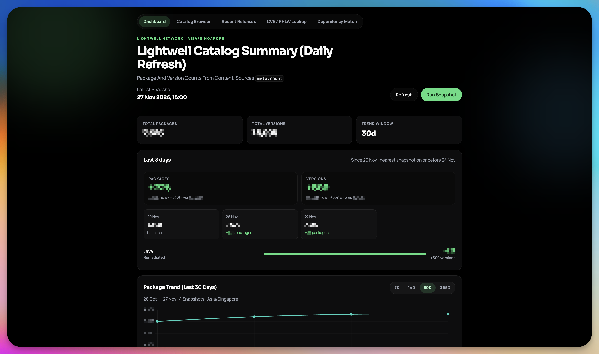

# Lightwell Catalog Web App (Google Apps Script)

.

Cloud app for Lightwell **catalog** workflows on `console.redhat.com` content-sources:

| Page | URL | What it does |
|---|---|---|
| **Dashboard** | `/exec` | Daily package/version count trends (Sheet-backed) |
| **Catalog Browser** | `/exec?page=browser` | Search packages → drill into versions → registry links |
| **Recent Releases** | `/exec?page=recent` | Newest 300 package publications (filter + paginate) |
| **CVE / RHLW Lookup** | `/exec?page=cve` | Search the OSV catalog by CVE id, `RHLW-` id, package, or remediated release |
| **Dependency Match** | `/exec?page=match` | Paste package names → batch catalog hits |
| **Access** | `/exec?page=access` | Owner-only list of Google accounts allowed to open the app |

Triggers run in **Asia/Singapore** at **08:00** and **15:00**: OSV severity index and catalog snapshots.

## Project files (paste all into Apps Script)

| File | Role |
|---|---|
| `Code.gs` | `doGet` router, dashboard HTML, Sheet/triggers |
| `Access.gs` | Approved-email gate and the owner’s add/remove API |
| `Api.gs` | content-sources helpers + `google.script.run` APIs |
| `Registry.gs` | `packages.redhat.com` proxy using `LW_USER` / `LW_TOKEN` |
| `Osv.gs` | Daily OSV severity index and `osv-advisories.json` for CVE / RHLW Lookup |
| `Styles.html` | Shared dark UI |
| `Browser.html` | Catalog Browser page |
| `Recent.html` | Recent Releases page |
| `Cve.html` | CVE Lookup page |
| `Match.html` | Dependency Match page |
| `Allowlist.html` | Access page (owner manages approved emails) |

In the Apps Script editor: **+** → Script / HTML for each file (names must match exactly, without path).

## One-time setup

1. Create a Google Sheet and copy its id from the URL.
2. [script.google.com](https://script.google.com) → **New project** → add all files above.
3. **Project Settings → Script properties**:

| Property | Value |
|---|---|
| `AUTH_MODE` | `offline` or `service_account` |
| `OFFLINE_TOKEN` | From [Red Hat API Tokens](https://access.redhat.com/management/api) *(if offline)* |
| `CLIENT_ID` / `CLIENT_SECRET` | Hybrid Console SA *(if service_account)* |
| `SPREADSHEET_ID` | Sheet id |
| `SHEET_NAME` | `CatalogSummary` *(optional)* |
| `DRIVE_FOLDER_ID` | Optional Drive folder for `catalog-summary.html` |
| `WEBAPP_KEY` | Optional shared secret (`?key=…`) |
| `CHART_DAYS` | Default trend window *(optional, 7–365)* |
| `LW_USER` | Registry username (`1234567\|name`) for `packages.redhat.com` |
| `LW_TOKEN` | Registry token (Basic Auth password) — **not** the offline JWT |

**Open / Browse registry** links go through an Apps Script proxy (`?page=registry&path=lightwell/…`) so the browser is not prompted for Basic Auth. Credentials never leave Script Properties. (Prefer `path=` over embedding a full `https://…` in `u=` — nested URLs break Google’s web-app router and show a Drive error page.)

Anyone who can open the web app can browse the registry as that service account. The approved-email list is the gate. `WEBAPP_KEY` is an optional extra secret on the URL.

4. Run **`runCatalogSnapshot`** once (authorize UrlFetch + Drive/Sheets).
5. Run **`syncOsvIndex`** once (builds the CVE index; it reschedules itself if the run hits the time limit).
6. Run **`installTriggers`** once (OSV index and snapshots at 08:00 and 15:00 SGT).
7. **Deploy → New deployment → Web app**
   - Execute as: **Me** (required — tokens and Drive stay on your account, and your email is the owner)
   - Who has access: **Anyone in Red Hat** (the script then allows only emails on the Access list, starting with yours)

`jgoh@redhat.com` is the owner (`ACCESS_OWNER_EMAIL` in `Access.gs`) and is always on the list. Open **Access** in the nav to add or remove other Red Hat Google accounts. The owner row cannot be removed. People outside the Red Hat Workspace do not get an email from Google, so they are denied. `logAccessIdentity` in the editor prints the email Apps Script sees.

## CVE column

Catalog Browser fills the versions **CVE** badge from `osv-severity-index.json` in Drive (`DRIVE_FOLDER_ID` when set, otherwise My Drive). The job reads the Java and Python OSV trees with `LW_USER` / `LW_TOKEN`. Predisclosure trees are included when that account is entitled; a 403 on those trees is skipped. Opening a package does not scan those files.

Until the first successful sync, the column stays blank and the versions status says the index is not built. `syncOsvIndexForce` rebuilds even if today's index is already fresh. Scores are CVSS v3 base scores: 9.0+ critical, 7.0+ important, 4.0+ moderate, otherwise low.

The same sync writes `osv-advisories.json`. CVE / RHLW Lookup searches that file (CVE id, `RHLW-…` id, package name, or a remediated release such as `2.8.0.rhlw-00001`). After pasting a new `Osv.gs`, run `syncOsvIndexForce` once so the advisory file exists. The content-sources `/lightwell/advisories` API is only a fallback for a CVE id before that file is built.

## After every code change

Saving is not enough for `/exec`:

1. **Deploy → Manage deployments → ✎ Edit → Version: New version → Deploy**
2. Hard-refresh `/exec` (Cmd+Shift+R)

Test latest editor code without redeploy: **Deploy → Test deployments** (`/dev`, you only).

If nav buttons go blank white: links must use `target="_top"` + absolute `/exec` URLs (already wired).

## Hosting notes

**Apps Script is a good fit** for an internal tool: free, Sheet-backed, your Red Hat tokens stay in Script Properties, no separate server.

Consider something else when you need:

| Need | Better host |
|---|---|
| Team CI, Docker, Python OSV sync + download in one place | **Cloud Run / Render** wrapping this repo’s Python CLIs |
| Heavy batch crawls / large dependency graphs | Backend job + DB (Apps Script has ~6 min / UrlFetch quotas) |
| Public anonymous access | Don’t — keep Execute as **Me**, share with Red Hat, and use the Access list |

Directory listings open via the authenticated proxy. Large binary downloads may still be better via the local Python downloader (Apps Script inline download cap ~4 MB).

## API surface used

- `GET /lightwell/packages` — browser + dependency match
- `GET /lightwell/package_versions` — version drill-down
- `GET /lightwell/advisories?cve_id=` — CVE fallback only, before the OSV advisory file exists
- Sheet snapshots — dashboard trends (not a live full-catalog crawl)

## Troubleshooting

1. Empty Sheet → check **CatalogSummary** tab + Executions log (`OFFLINE_TOKEN` / `SPREADSHEET_ID`).
2. Browser search 401 → refresh offline token or switch to Hybrid Console SA.
3. HTML files 404 in template → confirm Apps Script file names are exactly `Browser`, `Cve`, `Match`, `Styles` (no `.html` in the editor name field beyond type HTML).
